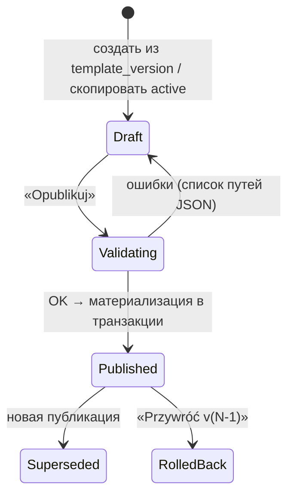

# OWO — спецификация Configuration Engine и динамических сущностей

> Проект. Все SQL — примеры для будущих миграций, сейчас не применяются.
> Общие правила для всех таблиц: `organization_id uuid not null`, `unique (organization_id, id)`,
> составные FK `(organization_id, X_id)`, RLS включён, `revoke all from anon, authenticated` +
> точечные grant.

## 1. Хранение динамических данных — выбор модели

| Критерий | A. Таблица на сущность (DDL во время работы) | B. Одна таблица + JSONB | **C. Гибрид: типизированные колонки-значения (EAV-lite) + JSONB-снимок** |
|---|---|---|---|
| Производительность | лучшая | хорошая до ~10⁶ записей при GIN/expression-индексах | хорошая: фильтры по индексированной таблице значений |
| Сложность запросов | простая SQL, но динамический DDL | jsonb-операторы, касты | генератор запросов (один на платформу) |
| Индексы | обычные | expression-индексы на каждое поле = DDL | универсальные индексы по `(entity_type, field, value_*)` без DDL |
| RLS | политика на каждую новую таблицу (DDL) | одна политика | одна политика на 3 таблицы |
| Целостность | FK, check | **нет типизации, нет FK** | типы через колонки `value_*`, ссылки через `record_links` с FK |
| Миграции/поля | ALTER TABLE на живой базе от админки — риск блокировок | бесплатно | бесплатно |
| Отчёты | SQL | сложно | SQL через `record_values` |
| Небольшая команда | опасно (DDL из админки) | просто, но долги типизации | умеренно |

**Решение (D-04):** вариант **C** для динамических сущностей + **настоящие таблицы** для
стандартных и денежных сущностей. JSONB-снимок `records.data` служит для быстрой отрисовки
карточки, источник правды для фильтров/уникальности/ссылок — `record_values` и `record_links`.
Если сущность модуля перерастает движок (миллионы строк, сложные отчёты), модуль переводит её
в свою таблицу — интерфейс полей тот же.

## 2. Метаданные

```sql
create table public.entity_types (
  id uuid primary key default gen_random_uuid(),
  organization_id uuid not null references public.organizations(id) on delete cascade,
  key text not null check (key ~ '^[a-z][a-z0-9_]{1,40}$'),     -- 'vehicle'
  storage text not null check (storage in ('records','table')), -- table = стандартная/модульная
  table_name text,                                               -- 'leads' для storage=table
  module_key text,                                               -- кто объявил ('automotive', null = OWO custom)
  label_singular jsonb not null, label_plural jsonb not null,    -- {"pl":"Pojazd"}
  icon text check (icon in (/* реестр иконок */ 'car','user','calendar','home','file','wrench','tag')),
  title_template text not null default '{{name}}',               -- как называется запись
  config_version_id uuid not null,                               -- в какой версии появилась
  archived_at timestamptz,
  unique (organization_id, id), unique (organization_id, key)
);

create table public.entity_fields (
  id uuid primary key default gen_random_uuid(),
  organization_id uuid not null,
  entity_type_id uuid not null,
  key text not null check (key ~ '^[a-z][a-z0-9_]{1,40}$'),
  type text not null check (type in ('text','long_text','number','money','date','datetime',
        'boolean','select','multiselect','email','phone','url','file','relation','json')),
  label jsonb not null,
  required boolean not null default false,
  is_unique boolean not null default false,
  searchable boolean not null default false,
  filterable boolean not null default true,
  default_value jsonb,
  validation jsonb not null default '{}',   -- {"min":0,"max":100,"maxLength":120,"pattern":null}
  options jsonb,                              -- select: [{"key":"diesel","label":{"pl":"Diesel"}}]
  relation jsonb,                             -- {"target":"contact","cardinality":"many_to_one","onDelete":"restrict"}
  position int not null default 0,
  column_name text,                           -- для storage=table: реальная колонка (read-only в конструкторе)
  archived_at timestamptz,
  unique (organization_id, id), unique (organization_id, entity_type_id, key),
  foreign key (organization_id, entity_type_id) references public.entity_types(organization_id, id)
);
```
`json` разрешён только для модулей (не в конструкторе для клиента), D-04.

## 3. Данные записей

```sql
create table public.records (
  id uuid primary key default gen_random_uuid(),
  organization_id uuid not null,
  entity_type_id uuid not null,
  number bigint not null,                 -- человекочитаемый номер per entity_type
  title text not null default '',         -- вычислен из title_template
  data jsonb not null default '{}',       -- снимок для отображения
  pipeline_id uuid, stage_id uuid,        -- если у сущности процесс
  owner_id uuid references auth.users(id),
  created_by uuid, created_at timestamptz not null default now(),
  updated_at timestamptz not null default now(),
  deleted_at timestamptz,
  unique (organization_id, id),
  unique (organization_id, entity_type_id, number),
  foreign key (organization_id, entity_type_id) references public.entity_types(organization_id, id)
);
create index records_type_idx on public.records (organization_id, entity_type_id, created_at desc) where deleted_at is null;
create index records_title_trgm on public.records using gin (title gin_trgm_ops);

-- Типизированные значения: одна строка на (запись, поле). Ровно одна value_* заполнена.
create table public.record_values (
  organization_id uuid not null,
  record_id uuid not null,
  field_id uuid not null,
  value_text text, value_number numeric, value_money bigint,  -- гроши
  value_date date, value_ts timestamptz, value_bool boolean,
  value_options text[],                                        -- select/multiselect: ключи опций
  primary key (record_id, field_id),
  foreign key (organization_id, record_id) references public.records(organization_id, id) on delete cascade,
  foreign key (organization_id, field_id) references public.entity_fields(organization_id, id),
  check (num_nonnulls(value_text,value_number,value_money,value_date,value_ts,value_bool,value_options) <= 1)
);
create index rv_text_idx   on public.record_values (organization_id, field_id, lower(value_text));
create index rv_number_idx on public.record_values (organization_id, field_id, value_number);
create index rv_money_idx  on public.record_values (organization_id, field_id, value_money);
create index rv_date_idx   on public.record_values (organization_id, field_id, value_date);
create index rv_opts_idx   on public.record_values using gin (value_options);

-- Уникальность полей с is_unique=true
create table public.record_unique_keys (
  organization_id uuid not null, field_id uuid not null, normalized text not null, record_id uuid not null,
  primary key (organization_id, field_id, normalized),
  foreign key (organization_id, record_id) references public.records(organization_id, id) on delete cascade
);

-- Связи: и между records, и между records ↔ стандартными таблицами.
create table public.record_links (
  id uuid primary key default gen_random_uuid(),
  organization_id uuid not null,
  field_id uuid not null,                  -- поле-relation, определяет смысл и кардинальность
  from_entity text not null, from_id uuid not null,
  to_entity text not null,   to_id uuid not null,
  created_at timestamptz not null default now(),
  unique (organization_id, field_id, from_id, to_id),
  foreign key (organization_id, field_id) references public.entity_fields(organization_id, id)
);
create index record_links_to_idx on public.record_links (organization_id, to_entity, to_id);
```

**Проверка ссылок между организациями.** Полиморфная ссылка не может иметь обычный FK, поэтому
вставка в `record_links` идёт **только** через функцию `record_link_add` (security invoker):
она проверяет `exists(select 1 from <target> where organization_id = :org and id = :to_id and deleted_at is null)`
через реестр `entity_types.table_name`, кардинальность (`many_to_one` → не больше одной связи
from), и что `from_entity` совпадает с сущностью поля. Прямой grant `insert` на таблицу не выдаётся.
Триггер на удаление записи (`deleted_at`) применяет `onDelete`: `restrict` / `cascade_soft` / `unlink`.

**Связь 1:1** = `cardinality: "one_to_one"` + уникальный индекс по `(field_id, from_id)` и
`(field_id, to_id)`; **1:N** = `many_to_one` на стороне «многих»; **N:M** = `many_to_many`.

## 4. RLS для динамических данных
```sql
alter table public.records enable row level security;
create policy rec_read on public.records for select to authenticated
  using (public.is_member(organization_id) and public.can('entity:'||public.entity_key(entity_type_id)||':read', organization_id));
create policy rec_write on public.records for insert to authenticated
  with check (public.is_member(organization_id) and public.can('entity:'||public.entity_key(entity_type_id)||':write', organization_id));
-- record_values, record_links: то же через exists(record) — значение без видимой записи не читается.
```
`can(permission, org)` — `security definer`, читает `memberships.role_id → role_permissions`
(кэшируется в `set_config` на транзакцию). Права на поля применяются в слое сервиса
(`lib/platform/records/service.ts`): скрытые поля не попадают в `data` ответа и не принимаются при записи.

## 5. Полный пример: автосервис

**1) Создание сущностей (в черновике конфигурации)**
```json
{
  "entities": [
    { "key": "vehicle", "storage": "records", "label": {"pl": ["Pojazd","Pojazdy"]}, "icon": "car",
      "titleTemplate": "{{brand}} {{model}} · {{plate}}",
      "fields": [
        {"key": "plate", "type": "text", "required": true, "unique": true, "searchable": true,
         "validation": {"pattern": "^[A-Z0-9 ]{4,10}$"}, "label": {"pl": "Nr rejestracyjny"}},
        {"key": "vin", "type": "text", "unique": true, "validation": {"maxLength": 17}},
        {"key": "brand", "type": "text", "required": true},
        {"key": "model", "type": "text"},
        {"key": "year", "type": "number", "validation": {"min": 1950, "max": 2100}},
        {"key": "fuel", "type": "select", "options": ["petrol","diesel","lpg","ev"]},
        {"key": "owner", "type": "relation",
         "relation": {"target": "contact", "cardinality": "many_to_one", "onDelete": "restrict"}}
      ]},
    { "key": "repair_order", "storage": "records", "label": {"pl": ["Zlecenie naprawy","Zlecenia"]},
      "pipeline": "repair_flow",
      "fields": [
        {"key": "vehicle", "type": "relation", "required": true,
         "relation": {"target": "vehicle", "cardinality": "many_to_one", "onDelete": "restrict"}},
        {"key": "mileage", "type": "number"},
        {"key": "complaint", "type": "long_text"},
        {"key": "estimate", "type": "money"},
        {"key": "mechanic", "type": "relation", "relation": {"target": "member", "cardinality": "many_to_one"}},
        {"key": "due_at", "type": "datetime"}
      ]}
  ]
}
```

**2) Публикация** материализует строки `entity_types`/`entity_fields` (см. §7).

**3) Создание записи** (Server Action → `records.create`):
```ts
await records.create(ctx, "vehicle", {
  plate: "GD 12345", brand: "Skoda", model: "Octavia", year: 2019, fuel: "diesel",
  owner: contactId,
});
```
Внутри одной транзакции: валидация по `entity_fields` (zod-схема, собранная из метаданных) →
`insert records` (number = `next_record_number`) → `insert record_values` → `record_unique_keys`
(plate, vin) → `record_link_add(owner)` → `activities('created')` → `domain_events('record.created')`.

**4) Связь ремонт → автомобиль** — та же функция для поля `vehicle` у `repair_order`.

**5) Фильтр «ремонты автомобилей клиента X»:**
```sql
select r.* from records r
join record_links lv on lv.from_id = r.id and lv.field_id = :repair_vehicle_field
join record_links lo on lo.from_id = lv.to_id and lo.field_id = :vehicle_owner_field
where r.organization_id = :org and lo.to_id = :contact_id and r.deleted_at is null;
```
Генерируется query-engine из фильтра `{"field":"vehicle.owner","op":"eq","value":":contact"}`
(глубина пути ≤ 2, D-10).

## 6. Конфигурация организации

```sql
create table public.templates (
  key text primary key,                     -- 'event_services', 'automotive', 'agency'
  label jsonb not null, description jsonb
);
create table public.template_versions (
  id uuid primary key default gen_random_uuid(),
  template_key text not null references public.templates(key),
  version int not null,                     -- 1,2,3…, неизменяема после публикации
  manifest jsonb not null,                  -- полный документ конфигурации
  schema_version int not null,              -- версия формата JSON
  published_at timestamptz, published_by uuid,
  unique (template_key, version)
);
create table public.organization_configs (   -- черновик, один на организацию
  organization_id uuid primary key references public.organizations(id) on delete cascade,
  base_template_version_id uuid references public.template_versions(id),
  draft jsonb not null,                     -- полный документ
  active_version_id uuid,                   -- что сейчас работает
  draft_updated_at timestamptz not null default now(), draft_updated_by uuid
);
create table public.config_versions (        -- опубликованные снимки, неизменяемы
  id uuid primary key default gen_random_uuid(),
  organization_id uuid not null references public.organizations(id) on delete cascade,
  version int not null,
  document jsonb not null,
  base_template_version_id uuid,
  diff_summary jsonb not null,              -- что изменилось (для аудита/отката)
  status text not null check (status in ('published','rolled_back','superseded')),
  published_at timestamptz not null default now(), published_by uuid not null,
  unique (organization_id, version), unique (organization_id, id)
);
```
Права: таблицы закрыты для `authenticated`; чтение активной версии — функция
`config_active(org)` (для участников, без черновика); запись — `config_*` функции только для
`platform_staff`.

### 6.1 Документ конфигурации (schema_version 1)
```json
{
  "schemaVersion": 1,
  "modules": ["crm_core","documents","payments","mailing","event_mgmt"],
  "settings": {"locale": "pl", "currency": "PLN", "timezone": "Europe/Warsaw"},
  "entities": [ "...как в §5..." ],
  "extendStandard": { "leads": [ {"key":"guests","type":"number"} ] },
  "pipelines": [ "...см. WORKFLOW spec..." ],
  "roles": [
    {"key":"owner","system":true},
    {"key":"mechanic","label":{"pl":"Mechanik"},
     "permissions":["entity:repair_order:read","entity:repair_order:write","entity:vehicle:read",
                    "field:repair_order.estimate:read"]}
  ],
  "navigation": [
    {"group": {"pl":"Praca"}, "items": [
      {"type":"view","view":"repair_board","icon":"wrench"},
      {"type":"view","view":"vehicles_table","icon":"car"},
      {"type":"module_page","module":"event_mgmt","page":"calendar"}
    ]}
  ],
  "views": [
    {"key":"repair_board","entity":"repair_order","kind":"kanban","groupBy":"stage",
     "card":{"title":"title","lines":["vehicle","mechanic","due_at"]},
     "filters":[{"field":"stage.role","op":"neq","value":"lost"}]},
    {"key":"vehicles_table","entity":"vehicle","kind":"table",
     "columns":["plate","brand","model","owner","year"],"sort":[{"field":"plate"}]}
  ],
  "forms": [
    {"key":"vehicle_form","entity":"vehicle","sections":[
      {"title":{"pl":"Pojazd"},"fields":["plate","vin","brand","model","year","fuel"]},
      {"title":{"pl":"Właściciel"},"fields":["owner"]}]}
  ],
  "recordPages": [
    {"entity":"vehicle","layout":"two_column","main":[{"widget":"fields","form":"vehicle_form"},
       {"widget":"related_list","relation":"repair_order.vehicle","view":"repair_mini"}],
     "side":[{"widget":"quick_actions","actions":["call_owner","create_repair"]},{"widget":"activity"}]}
  ],
  "dashboards": [
    {"key":"home","widgets":[{"type":"kpi","metric":"count","entity":"repair_order","filter":{"stage.role":"open"}},
                             {"type":"list","view":"repair_today"}]}
  ],
  "automations": [ "...см. WORKFLOW spec..." ],
  "integrations": {"channels":[{"type":"webhook","entity":"leads","fieldMap":{"telefon":"phone"}}]}
}
```

### 6.2 Жизненный цикл


**Валидация** (`lib/platform/config/validate.ts`, zod + семантика):
1. JSON-схема формата `schemaVersion`.
2. Ключи уникальны, все ссылки (view→entity, field→entity, relation.target, navigation→view,
   automation.action) существуют в документе или реестре модулей.
3. Типы полей и виджетов — только из реестра (`lib/platform/registry.ts`).
4. Модули: зависимости включены, модуль доступен тарифу.
5. **Разрушающие изменения** против активной версии: удаление поля с данными, смена типа поля,
   смена кардинальности связи, удаление этапа с записями → требуют явного плана
   (`"migrations":[{"field":"fuel","action":"archive"}]`), иначе ошибка.
6. Права: у каждой сущности есть хотя бы одна роль с `read`.

**Материализация (`config_publish(org)`, одна транзакция):** upsert `entity_types`,
`entity_fields`, `pipelines`, `pipeline_stages`, `pipeline_transitions`, `roles`,
`role_permissions`, `automation_rules`, `views`. Поля и сущности **никогда не удаляются
физически** — `archived_at`. Смена типа поля = новое поле + перенос значений функцией модуля +
архив старого. Запись `config_versions` + `audit_log`. Кэш конфигурации сбрасывается
(`pg_notify('config_changed', org)`).

**Загрузка:** `getActiveConfig(orgId)` — React `cache` на запрос + in-memory LRU по
`(org, version)`; версия читается из `organization_configs.active_version_id`.

**Откат:** публикация копии документа версии N-1 как новой версии (история не переписывается).
Архивированные поля возвращаются (данные не удалялись). Нельзя откатить, если между версиями
шла миграция значений, — валидатор показывает это.

### 6.3 Шаблоны
- Создание CRM: `template_versions.manifest` → `organization_configs.draft` (+
  `base_template_version_id`) → публикация.
- Индивидуальная адаптация — правка черновика организации.
- **Обновление шаблона** не распространяется автоматически. В админке OWO у организации видно
  «доступна версия шаблона 4 (сейчас 3)» → трёхстороннее слияние по ключам: изменения шаблона
  применяются там, где организация не меняла элемент; конфликты показываются списком.
- Шаблоны: `event_services` (Barowo), `agency` (OWO Ads), `automotive`, `real_estate`.

## 7. Конструктор интерфейса

**Динамически рендерится** (из `views/forms/recordPages/dashboards/navigation`), набор
компонентов фиксирован в коде `components/platform/*`:
`EntityTable`, `EntityKanban`, `EntityCalendar`, `EntityList`, `RecordPage`, `FieldRenderer`
(по типу поля), `FormRenderer`, `FilterBar`, `KpiWidget`, `ChartWidget(bar|line|stacked)`,
`RelatedList`, `ActivityFeed`, `QuickActions`, `ModuleWidget(key)`.

**Остаётся обычным кодом:** оболочка (auth, переключатель бизнеса, ⌘K), админка конфигурации
OWO, страницы модулей со сложной логикой (финансы агентства, генераторы документов, Reklama),
мастера (импорт, подключение каналов, Stripe).

Безопасность UI: в конфигурации только ключи компонентов и данных; никакого JSX/HTML/JS;
тексты экранируются; URL в действиях — только `https:` или внутренние маршруты из реестра.

Маршруты: `/r/[entity]` (представление по умолчанию), `/r/[entity]/[id]`, `/v/[view]`,
`/m/[module]/...` — рядом с существующими страницами, которые продолжают работать.
