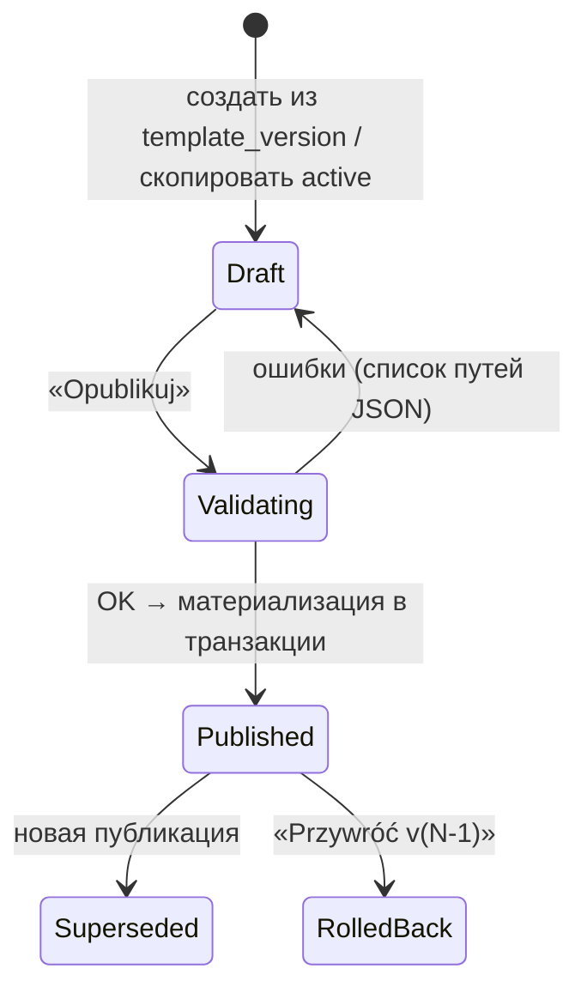

# OWO — спецификация Configuration Engine и динамических сущностей

> Проект. Все SQL — примеры для будущих миграций, сейчас не применяются.
> Общие правила для всех таблиц: `organization_id uuid not null`, `unique (organization_id, id)`,
> составные FK `(organization_id, X_id)`, RLS включён, `revoke all from anon, authenticated` +
> точечные grant.

## 1. Хранение динамических данных — выбор модели

| Критерий | A. Таблица на сущность (DDL во время работы) | B. Одна таблица + JSONB | **C. Гибрид: типизированные колонки-значения (EAV-lite) + JSONB-снимок** |
|---|---|---|---|
| Производительность | лучшая | хорошая до ~10⁶ записей при GIN/expression-индексах | хорошая: фильтры по индексированной таблице значений |
| Сложность запросов | простая SQL, но динамический DDL | jsonb-операторы, касты | генератор запросов (один на платформу) |
| Индексы | обычные | expression-индексы на каждое поле = DDL | универсальные индексы по `(entity_type, field, value_*)` без DDL |
| RLS | политика на каждую новую таблицу (DDL) | одна политика | одна политика на 3 таблицы |
| Целостность | FK, check | **нет типизации, нет FK** | типы через колонки `value_*`, ссылки через `record_links` с FK |
| Миграции/поля | ALTER TABLE на живой базе от админки — риск блокировок | бесплатно | бесплатно |
| Отчёты | SQL | сложно | SQL через `record_values` |
| Небольшая команда | опасно (DDL из админки) | просто, но долги типизации | умеренно |

**Решение (D-04):** вариант **C** для динамических сущностей + **настоящие таблицы** для
стандартных и денежных сущностей. Источник правды значений — `record_values`, связей —
`record_links`, файлов — `record_files`. **JSONB-снимка значений в `records` нет** (иначе скрытые
поля были бы читаемы в обход прав, см. §4). Если сущность модуля перерастает движок
(миллионы строк, сложные отчёты), модуль переводит её в свою таблицу — интерфейс полей тот же.

## 2. Метаданные

```sql
create table public.entity_types (
  id uuid primary key default gen_random_uuid(),
  organization_id uuid not null references public.organizations(id) on delete cascade,
  key text not null check (key ~ '^[a-z][a-z0-9_]{1,40}$'),     -- 'vehicle'
  storage text not null check (storage in ('records','table')), -- table = стандартная/модульная
  table_name text check ((storage = 'table') = (table_name is not null)), -- 'leads'
  module_key text,                                               -- кто объявил ('automotive', null = OWO custom)
  label text not null,                                           -- «Pojazd» (только польский, D-17)
  label_plural text not null,                                    -- «Pojazdy»
  icon text check (icon in ('car','user','calendar','home','file','wrench','tag','bank')),
  title_template text not null default '{{name}}',
  config_version_id uuid,                                        -- null = зарегистрирована миграцией (M4.1, до Config Engine)
  archived_at timestamptz,
  unique (organization_id, id), unique (organization_id, key)
);

create table public.entity_fields (
  id uuid primary key default gen_random_uuid(),
  organization_id uuid not null,
  entity_type_id uuid not null,
  key text not null check (key ~ '^[a-z][a-z0-9_]{1,40}$'),
  type text not null check (type in ('text','long_text','number','money','date','datetime',
        'boolean','select','multiselect','email','phone','url','file','relation','json')),
  label text not null,
  required boolean not null default false,
  is_unique boolean not null default false
    check (not is_unique or type in ('text','email','phone','url','number')),
  searchable boolean not null default false,
  filterable boolean not null default true,
  sensitive boolean not null default false,   -- чувствительные данные: чтение журналируется (§4.4)
  default_value jsonb,
  validation jsonb not null default '{}',     -- {"min":0,"max":100,"maxLength":120,"pattern":null}
  options jsonb,                              -- select: [{"key":"diesel","label":"Diesel"}]
  relation jsonb,                             -- {"target":"contact","cardinality":"many_to_one","onDelete":"restrict"}
  json_schema_key text,                       -- только type='json': ключ схемы из реестра модуля
  position int not null default 0,
  column_name text,                           -- для storage=table: реальная колонка (read-only в конструкторе)
  archived_at timestamptz,
  unique (organization_id, id), unique (organization_id, entity_type_id, key),
  foreign key (organization_id, entity_type_id) references public.entity_types(organization_id, id),
  check ((type = 'relation') = (relation is not null)),
  check ((type = 'json') = (json_schema_key is not null))
);
```

### 2.1 Тип поля → место хранения (окончательно)

| `entity_fields.type` | Хранение | Индекс / проверка |
|---|---|---|
| `text`, `long_text` | `record_values.value_text` | `lower(value_text)`; long_text — без индекса, `searchable` → trigram |
| `email` | `value_text` (нижний регистр) | валидация формата в сервисе и `check` в функции записи |
| `phone` | `value_text` (E.164 `+48…`) | нормализация как `phone_e164` у лидов |
| `url` | `value_text` | только `https://` |
| `number` | `value_number numeric` | btree |
| `money` | `value_money bigint` (гроши) | btree |
| `date` | `value_date` | btree |
| `datetime` | `value_ts timestamptz` | btree |
| `boolean` | `value_bool` | — |
| `select`, `multiselect` | `value_options text[]` (ключи опций; select — ровно 1) | GIN |
| `relation` | **`record_links`** (в `record_values` нет строки) | см. §3.2 |
| `file` | **`record_files`** → `files` | см. §3.3 |
| `json` | `value_json jsonb` | **только поля модулей** с зарегистрированной zod-схемой (`json_schema_key`); в конструкторе OWO недоступен; не фильтруется, не уникален |

Для `storage = 'table'` поля с `column_name` хранятся в колонке своей таблицы (например, `leads.event_date`);
поля, добавленные конфигурацией к стандартной сущности, — в `record_values` с `record_id = <id строки таблицы>`.

## 3. Данные записей

```sql
create table public.records (
  id uuid primary key default gen_random_uuid(),
  organization_id uuid not null,
  entity_type_id uuid not null,
  number bigint not null,                 -- человекочитаемый номер per entity_type
  title text not null default '',         -- из title_template; поля sensitive в шаблон заголовка не допускаются (валидатор)
  pipeline_id uuid, stage_key text,       -- если у сущности процесс
  owner_id uuid references auth.users(id),
  created_by uuid, created_at timestamptz not null default now(),
  updated_at timestamptz not null default now(),
  deleted_at timestamptz,
  unique (organization_id, id),
  unique (organization_id, entity_type_id, number),
  foreign key (organization_id, entity_type_id) references public.entity_types(organization_id, id)
);
create index records_type_idx on public.records (organization_id, entity_type_id, created_at desc) where deleted_at is null;
create index records_title_trgm on public.records using gin (title gin_trgm_ops);

-- Значения. record_id — id записи records ИЛИ строки стандартной таблицы (storage=table),
-- поэтому FK на records нет; целостность — через record_ref_check (§3.2) и FK на поле.
create table public.record_values (
  organization_id uuid not null,
  entity_type_id uuid not null,
  record_id uuid not null,
  field_id uuid not null,
  value_text text, value_number numeric, value_money bigint,
  value_date date, value_ts timestamptz, value_bool boolean,
  value_options text[], value_json jsonb,
  primary key (organization_id, record_id, field_id),
  foreign key (organization_id, field_id) references public.entity_fields(organization_id, id),
  foreign key (organization_id, entity_type_id) references public.entity_types(organization_id, id),
  check (num_nonnulls(value_text,value_number,value_money,value_date,value_ts,value_bool,value_options,value_json) <= 1)
);
create index rv_text_idx   on public.record_values (organization_id, field_id, lower(value_text));
create index rv_number_idx on public.record_values (organization_id, field_id, value_number);
create index rv_money_idx  on public.record_values (organization_id, field_id, value_money);
create index rv_date_idx   on public.record_values (organization_id, field_id, value_date);
create index rv_ts_idx     on public.record_values (organization_id, field_id, value_ts);
create index rv_opts_idx   on public.record_values using gin (value_options);
-- Соответствие колонки типу поля проверяет триггер rv_type_check (тип читается из entity_fields):
-- email/phone/url/text → только value_text; money → только value_money; и т.д.

-- Уникальность полей с is_unique=true (нормализованное значение).
create table public.record_unique_keys (
  organization_id uuid not null, field_id uuid not null, normalized text not null, record_id uuid not null,
  primary key (organization_id, field_id, normalized),
  foreign key (organization_id, field_id) references public.entity_fields(organization_id, id)
);
-- Удаление записи (deleted_at) удаляет её ключи — освобождает значение для новой записи.
```

### 3.1 Номер и удаление
`next_record_number(org, entity_type)` — счётчик в `record_counters (organization_id, entity_type_id, last)`
с `update … returning` (как `document_counters`). Удаление мягкое (`deleted_at`); физическое — только
задачей очистки RODO, по одной записи, с аудитом.

### 3.2 Связи

```sql
create table public.record_links (
  id uuid primary key default gen_random_uuid(),
  organization_id uuid not null,
  field_id uuid not null,                  -- поле-relation, определяет смысл и кардинальность
  from_entity_id uuid not null, from_id uuid not null,
  to_entity_id uuid not null,   to_id uuid not null,
  created_at timestamptz not null default now(),
  unique (organization_id, field_id, from_id, to_id),
  foreign key (organization_id, field_id)        references public.entity_fields(organization_id, id),
  foreign key (organization_id, from_entity_id)  references public.entity_types(organization_id, id),
  foreign key (organization_id, to_entity_id)    references public.entity_types(organization_id, id)
);
create index record_links_to_idx on public.record_links (organization_id, to_entity_id, to_id);
-- Для many_to_one / one_to_one публикация создаёт частичный индекс на конкретное поле, например:
-- create unique index record_links_one_<field> on public.record_links (organization_id, from_id)
--   where field_id = '<field uuid>';
```
Межорганизационную ссылку исключают **три уровня**:
1. Составные FK: поле и обе сущности принадлежат той же `organization_id`, что и связь.
2. `record_ref_check(org, entity_type_id, id)` (security definer, вызывается из `record_link_add`
   и триггера `before insert` на `record_links`): строка существует в таблице сущности
   (`records` или `entity_types.table_name`) **с тем же `organization_id`** и `deleted_at is null`.
   Имя таблицы берётся только из `entity_types.table_name` и проверяется по белому списку
   (`leads`, `contacts`, `companies`, `payments`, `tasks`, `memberships`-представление участников).
3. Прямого `insert/update/delete` на `record_links` у роли `authenticated` нет — только функции.

Кардинальность: `many_to_one`/`one_to_one` → частичный уникальный индекс по `(field_id, from_id)`,
`one_to_one` дополнительно по `(field_id, to_id)` (создаются функцией публикации для конкретного
`field_id`); `many_to_many` — без них. `onDelete`: `restrict` (удаление записи-цели запрещено, если есть
связи), `unlink` (связи удаляются), `cascade_soft` (связанные записи получают `deleted_at`).

### 3.3 Файлы
```sql
create table public.record_files (
  organization_id uuid not null, field_id uuid not null, record_id uuid not null, file_id uuid not null,
  primary key (organization_id, field_id, record_id, file_id),
  foreign key (organization_id, field_id) references public.entity_fields(organization_id, id),
  foreign key (organization_id, file_id)  references public.files(organization_id, id) on delete cascade
);
```
`files` — общая таблица Platform Core (M3), сегодня это `lead_attachments` (`bytea`).

## 4. Безопасность динамических данных (окончательный вариант)

**Принцип:** у роли `authenticated` **нет прямого доступа к сырым значениям**. Чтение и запись
только через функции, которые применяют права на сущность **и** на каждое поле. Это не зависит от
TypeScript-сервиса: даже если UI или Server Action содержит ошибку, функция не вернёт скрытое поле.

### 4.1 Права на таблицы
```sql
revoke all on public.records, public.record_values, public.record_links, public.record_files,
              public.record_unique_keys from anon, authenticated;
-- records: только метаданные строки (без значений) — допускаем select через RLS для списков и связей.
grant select (id, organization_id, entity_type_id, number, title, pipeline_id, stage_key,
              owner_id, created_at, updated_at, deleted_at) on public.records to authenticated;
alter table public.records enable row level security;
create policy rec_read on public.records for select to authenticated
  using (public.can(organization_id, 'entity:' || public.entity_key(entity_type_id) || ':read'));
-- record_values / record_links / record_files: RLS включён, политик для authenticated нет → 0 строк.
alter table public.record_values enable row level security;
alter table public.record_links  enable row level security;
alter table public.record_files  enable row level security;
```

### 4.2 Функции чтения (security definer, `search_path = ''`)
- `record_read(p_org uuid, p_entity text, p_id uuid) returns jsonb` — значения только полей, для
  которых `can(p_org, 'field:<entity>.<key>:read')` (по умолчанию поле читаемо, если читаема сущность;
  `sensitive = true` → по умолчанию **закрыто**, нужно явное право).
- `records_query(p_org uuid, p_entity text, p_filter jsonb, p_sort jsonb, p_limit int, p_offset int)
  returns setof jsonb` — фильтр разрешён **только** по полям, которые пользователь может читать
  (иначе фильтр по скрытому полю раскрывал бы значение перебором); `p_filter` разбирается в
  параметризованный SQL по белому списку операторов, без конкатенации значений.
- `record_links_read(p_org, p_entity, p_id, p_field)` — связи только при праве на поле-relation и
  праве `read` на целевую сущность.
Каждая функция в начале проверяет `public.is_member(p_org)` и что `p_org` = организация из
`withOrg` (`current_setting('app.org_id')`) — пользователь не может подставить чужой `p_org`.

### 4.3 Функции записи
`record_write(p_org, p_entity, p_id, p_patch jsonb, p_version timestamptz)`: проверка
`entity:…:write`, затем для каждого ключа `field:…:write`; неизвестный или запрещённый ключ →
ошибка (не тихий пропуск); валидация типа и `validation`; уникальность; запись `activities` и
`domain_events` в той же транзакции. Связи — `record_link_add/remove`, файлы — `record_file_add/remove`
с теми же проверками.

### 4.4 Аудит чувствительных данных (D-19, утверждено)
```sql
create table public.sensitive_access_log (
  id bigint generated always as identity primary key,
  organization_id uuid not null,
  actor_id uuid not null,               -- пользователь, системный актор автоматизации или platform_staff
  actor_kind text not null check (actor_kind in ('member','platform_staff','automation')),
  entity_type_id uuid not null,
  record_id uuid not null,
  field_id uuid not null,               -- строка на каждое поле
  action text not null check (action in ('read','write','export')),
  result text not null check (result in ('granted','denied')),
  request_id text not null,             -- id запроса/запуска (app.request_id), для сквозного поиска
  retain_until date not null default (current_date + interval '24 months'),
  legal_hold boolean not null default false,   -- документированная необходимость хранить дольше
  created_at timestamptz not null default now(),
  foreign key (organization_id, field_id) references public.entity_fields(organization_id, id)
);
create index sal_org_time on public.sensitive_access_log (organization_id, created_at desc);
create index sal_retention on public.sensitive_access_log (retain_until) where not legal_hold;
```
- Пишут функции `record_read`, `records_query`, `record_write`, экспорт — по строке на каждое
  `sensitive`-поле, **включая отказы** (`result = 'denied'`). Значения полей не записываются никогда.
- `request_id` выставляет `withOrg` (`set_config('app.request_id', …)`), воркер — `run_id:step`.
- Журнал — append-only: `insert` только из функций, `update/delete` запрещены всем, кроме задания
  очистки. Чтение — owner организации и `platform_staff`.
- **Хранение 24 месяца** (утверждено как первоначальный срок): ежедневное задание воркера удаляет
  строки с `retain_until < current_date and not legal_hold`. `legal_hold` ставится только с записью
  причины в `audit_log`. Перед запуском CRM с чувствительными финансовыми данными срок
  подтверждается с ответственным за RODO и юристом.

### 4.5 Сценарий `mortgage_refi` (предварительный пример, не утверждён)
Все решения по сущностям, полям, ролям и срокам — после разговора с клиентом. Иллюстрация механизма:
поля текущего кредита (остаток, ставка, платёж, банк, PESEL/доходы — если появятся) помечаются
`sensitive`; роль «asystent» видит контакт и статус заявки, но не суммы кредита; экспорт CSV
таких полей — отдельное право `action:export_sensitive`. Сотрудник OWO с сервисным доступом
видит данные только при активном `organization_service_grants` (срок, причина), каждое чтение
журналируется. Требования RODO/KNF клиента — открытый вопрос (DECISIONS).

### 4.6 Тесты на обход интерфейса
- прямой `select * from record_values` / `record_links` под `authenticated` → 0 строк;
- `select data …` из `records` → ошибка (колонки нет), `select` скрытых колонок → permission denied;
- `records_query` с фильтром по `sensitive`-полю без права → ошибка, не пустой результат;
- `record_read` с `p_org` чужой организации → ошибка;
- `record_write` с ключом запрещённого поля → ошибка, значение не изменилось;
- чтение `sensitive`-поля создаёт строку `sensitive_access_log`; без права — не создаёт и не возвращает;
- `record_link_add` с `to_id` из другой организации → ошибка, даже при совпадающем `entity_key`.

## 5. Полный пример: автосервис

**1) Создание сущностей (в черновике конфигурации)**
```json
{
  "entities": [
    { "key": "vehicle", "storage": "records", "label": "Pojazd", "labelPlural": "Pojazdy", "icon": "car",
      "titleTemplate": "{{brand}} {{model}} · {{plate}}",
      "fields": [
        {"key": "plate", "type": "text", "required": true, "unique": true, "searchable": true,
         "validation": {"pattern": "^[A-Z0-9 ]{4,10}$"}, "label": "Nr rejestracyjny"},
        {"key": "vin", "type": "text", "unique": true, "validation": {"maxLength": 17}},
        {"key": "brand", "type": "text", "required": true},
        {"key": "model", "type": "text"},
        {"key": "year", "type": "number", "validation": {"min": 1950, "max": 2100}},
        {"key": "fuel", "type": "select", "options": ["petrol","diesel","lpg","ev"]},
        {"key": "owner", "type": "relation",
         "relation": {"target": "contact", "cardinality": "many_to_one", "onDelete": "restrict"}}
      ]},
    { "key": "repair_order", "storage": "records", "label": "Zlecenie naprawy", "labelPlural": "Zlecenia",
      "pipeline": "repair_flow",
      "fields": [
        {"key": "vehicle", "type": "relation", "required": true,
         "relation": {"target": "vehicle", "cardinality": "many_to_one", "onDelete": "restrict"}},
        {"key": "mileage", "type": "number"},
        {"key": "complaint", "type": "long_text"},
        {"key": "estimate", "type": "money"},
        {"key": "mechanic", "type": "relation", "relation": {"target": "member", "cardinality": "many_to_one"}},
        {"key": "due_at", "type": "datetime"}
      ]}
  ]
}
```

**2) Публикация** материализует строки `entity_types`/`entity_fields` (см. §6.2).

**3) Создание записи** (Server Action → `records.create`):
```ts
await records.create(ctx, "vehicle", {
  plate: "GD 12345", brand: "Skoda", model: "Octavia", year: 2019, fuel: "diesel",
  owner: contactId,
});
```
Сервис вызывает `record_write(org, 'vehicle', null, patch, null)`; внутри одной транзакции:
права → валидация по `entity_fields` → `insert records` (number = `next_record_number`) →
`insert record_values` → `record_unique_keys` (plate, vin) → `record_link_add(owner)` →
`activities('created')` → `domain_events('record.created')`. Сервис на TypeScript дублирует
валидацию только ради понятных сообщений об ошибках; граница безопасности — функция.

**4) Связь ремонт → автомобиль** — та же функция для поля `vehicle` у `repair_order`.

**5) Фильтр «ремонты автомобилей клиента X»:**
```sql
-- SQL, который строит records_query внутри security definer функции:
select r.id from public.records r
join public.record_links lv on lv.organization_id = r.organization_id and lv.from_id = r.id and lv.field_id = $2
join public.record_links lo on lo.organization_id = r.organization_id and lo.from_id = lv.to_id and lo.field_id = $3
where r.organization_id = $1 and lo.to_id = $4 and r.deleted_at is null;
```
Вызов из сервиса: `records_query(org, 'repair_order', '{"vehicle.owner":{"eq":"<contact>"}}', …)` — фильтр `{"field":"vehicle.owner","op":"eq","value":":contact"}`
(глубина пути ≤ 2, D-10).

### 5.1 Ограничения query engine (D-10, утверждено)
- Путь фильтра или сортировки — не более **2 связей** (`vehicle.owner.email` = 2 перехода);
  путь длиннее → ошибка валидации конфигурации/запроса, а не урезанный результат.
- Каждый шаг пути — поле `relation` с правом `read` на поле и на целевую сущность; конечное поле —
  с правом `read` и `filterable = true`; `sensitive`-поле в пути фильтра — только при явном праве
  (иначе фильтр раскрывал бы значение).
- Число условий в одном запросе ≤ 10, вложенность групп `all/any` ≤ 3, сортировка ≤ 2 полей,
  `limit` ≤ 200; рекурсия и произвольные JOIN не поддерживаются.
- Более сложные отчёты — проверенные SQL-функции специализированных модулей (ограничение D-10
  относится только к универсальному query engine).
- Тесты: путь из 3 связей отклоняется; путь через поле без права → ошибка; путь через запись
  другой организации ничего не возвращает; производительность — 100 тыс. записей, путь из 2
  связей + фильтр + сортировка < 300 мс (`tests/perf/records-query.test.ts`).

## 6. Конфигурация организации

```sql
create table public.templates (
  key text primary key,                     -- 'event_services', 'automotive', 'agency'
  label text not null, description text
);
create table public.template_versions (
  id uuid primary key default gen_random_uuid(),
  template_key text not null references public.templates(key),
  version int not null,                     -- 1,2,3…, неизменяема после публикации
  manifest jsonb not null,                  -- полный документ конфигурации
  schema_version int not null,              -- версия формата JSON
  published_at timestamptz, published_by uuid,
  unique (template_key, version)
);
create table public.organization_configs (   -- черновик, один на организацию
  organization_id uuid primary key references public.organizations(id) on delete cascade,
  base_template_version_id uuid references public.template_versions(id),
  draft jsonb not null,                     -- полный документ
  active_version_id uuid,                   -- что сейчас работает
  draft_updated_at timestamptz not null default now(), draft_updated_by uuid
);
create table public.config_versions (        -- опубликованные снимки, неизменяемы
  id uuid primary key default gen_random_uuid(),
  organization_id uuid not null references public.organizations(id) on delete cascade,
  version int not null,
  document jsonb not null,
  base_template_version_id uuid,
  diff_summary jsonb not null,              -- что изменилось (для аудита/отката)
  status text not null check (status in ('published','rolled_back','superseded')),
  published_at timestamptz not null default now(), published_by uuid not null,
  unique (organization_id, version), unique (organization_id, id)
);
```
Права: таблицы закрыты для `authenticated`; чтение активной версии — функция
`config_active(org)` (для участников, без черновика); запись — `config_*` функции только для
`platform_staff`.

### 6.1 Документ конфигурации (schema_version 1)
```json
{
  "schemaVersion": 1,
  "modules": ["crm_core","documents","payments","mailing","event_mgmt"],
  "settings": {"locale": "pl", "currency": "PLN", "timezone": "Europe/Warsaw"},
  "entities": [ "...как в §5..." ],
  "extendStandard": { "leads": [ {"key":"guests","type":"number"} ] },
  "pipelines": [ "...см. WORKFLOW spec..." ],
  "roles": [
    {"key":"owner","system":true},
    {"key":"mechanic","label":"Mechanik",
     "permissions":["entity:repair_order:read","entity:repair_order:write","entity:vehicle:read",
                    "field:repair_order.estimate:read"]}
  ],
  "navigation": [
    {"group": "Praca", "items": [
      {"type":"view","view":"repair_board","icon":"wrench"},
      {"type":"view","view":"vehicles_table","icon":"car"},
      {"type":"module_page","module":"event_mgmt","page":"calendar"}
    ]}
  ],
  "views": [
    {"key":"repair_board","entity":"repair_order","kind":"kanban","groupBy":"stage",
     "card":{"title":"title","lines":["vehicle","mechanic","due_at"]},
     "filters":[{"field":"stage.role","op":"neq","value":"lost"}]},
    {"key":"vehicles_table","entity":"vehicle","kind":"table",
     "columns":["plate","brand","model","owner","year"],"sort":[{"field":"plate"}]}
  ],
  "forms": [
    {"key":"vehicle_form","entity":"vehicle","sections":[
      {"title":"Pojazd","fields":["plate","vin","brand","model","year","fuel"]},
      {"title":"Właściciel","fields":["owner"]}]}
  ],
  "recordPages": [
    {"entity":"vehicle","layout":"two_column","main":[{"widget":"fields","form":"vehicle_form"},
       {"widget":"related_list","relation":"repair_order.vehicle","view":"repair_mini"}],
     "side":[{"widget":"quick_actions","actions":["call_owner","create_repair"]},{"widget":"activity"}]}
  ],
  "dashboards": [
    {"key":"home","widgets":[{"type":"kpi","metric":"count","entity":"repair_order","filter":{"stage.role":"open"}},
                             {"type":"list","view":"repair_today"}]}
  ],
  "automations": [ "...см. WORKFLOW spec..." ],
  "integrations": {"channels":[{"type":"webhook","entity":"leads","fieldMap":{"telefon":"phone"}}]}
}
```

### 6.2 Жизненный цикл


**Валидация** (`lib/platform/config/validate.ts`, zod + семантика):
1. JSON-схема формата `schemaVersion`.
2. Ключи уникальны, все ссылки (view→entity, field→entity, relation.target, navigation→view,
   automation.action) существуют в документе или реестре модулей.
3. Типы полей и виджетов — только из реестра (`lib/platform/registry.ts`).
4. Модули: зависимости включены, модуль доступен тарифу.
5. **Разрушающие изменения** против активной версии: удаление поля с данными, смена типа поля,
   смена кардинальности связи, удаление этапа с записями → требуют явного плана
   (`"migrations":[{"field":"fuel","action":"archive"}]`), иначе ошибка.
6. Права: у каждой сущности есть хотя бы одна роль с `read`.

**Материализация (`config_publish(org)`, одна транзакция):** upsert `entity_types`,
`entity_fields`, `pipelines`, `pipeline_stages`, `pipeline_transitions`, `roles`,
`role_permissions`, `automation_rules`, `views`. Поля и сущности **никогда не удаляются
физически** — `archived_at`. Смена типа поля = новое поле + перенос значений функцией модуля +
архив старого. Запись `config_versions` + `audit_log`. Кэш конфигурации сбрасывается
(`pg_notify('config_changed', org)`).

**Загрузка:** `getActiveConfig(orgId)` — React `cache` на запрос + in-memory LRU по
`(org, version)`; версия читается из `organization_configs.active_version_id`.

**Откат:** публикация копии документа версии N-1 как новой версии (история не переписывается).
Архивированные поля возвращаются (данные не удалялись). Нельзя откатить, если между версиями
шла миграция значений, — валидатор показывает это.

### 6.3 Шаблоны (D-13, утверждено)
- Каждый шаблон — неизменяемые версии `template_versions` (после публикации `manifest` не меняется).
- Создание CRM: `template_versions.manifest` → `organization_configs.draft` (+
  `base_template_version_id`) → публикация.
- Индивидуальная адаптация — правка черновика организации.
- **Обновление — только вручную, трёхстороннее слияние.** OWO сравнивает: (1) базовую версию
  шаблона организации, (2) новую версию шаблона, (3) текущую конфигурацию организации. Инструмент
  `config_template_diff(org, new_version)` показывает по ключам (сущность, поле, этап, представление,
  правило): «изменено только в шаблоне» (предлагается принять), «изменено только в организации»
  (сохраняется), «изменено в обоих» (конфликт, решает OWO). Принятые изменения попадают в
  черновик; публикация — обычная (валидация, `config_versions`), `base_template_version_id`
  обновляется. **Автоматического обновления клиентских CRM нет.**
- Шаблоны: `event_services` (Barowo), `agency` (OWO Ads), `automotive` (технический тест);
  `mortgage_refi` — после интервью с клиентом.

## 7. Конструктор интерфейса

**Динамически рендерится** (из `views/forms/recordPages/dashboards/navigation`), набор
компонентов фиксирован в коде `components/platform/*`:
`EntityTable`, `EntityKanban`, `EntityCalendar`, `EntityList`, `RecordPage`, `FieldRenderer`
(по типу поля), `FormRenderer`, `FilterBar`, `KpiWidget`, `ChartWidget(bar|line|stacked)`,
`RelatedList`, `ActivityFeed`, `QuickActions`, `ModuleWidget(key)`.

**Остаётся обычным кодом:** оболочка (auth, переключатель бизнеса, ⌘K), админка конфигурации
OWO, страницы модулей со сложной логикой (финансы агентства, генераторы документов, Reklama),
мастера (импорт, подключение каналов).

Безопасность UI: в конфигурации только ключи компонентов и данных; никакого JSX/HTML/JS;
тексты экранируются; URL в действиях — только `https:` или внутренние маршруты из реестра.

Маршруты: `/r/[entity]` (представление по умолчанию), `/r/[entity]/[id]`, `/v/[view]`,
`/m/[module]/...` — рядом с существующими страницами, которые продолжают работать.
