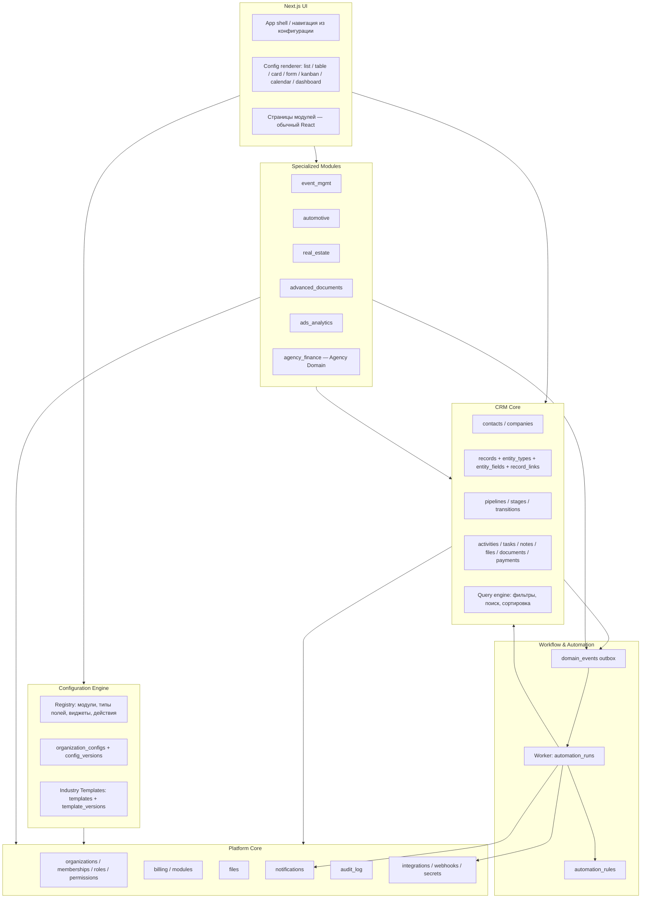

# OWO Platform — целевая архитектура

> Проектный документ. Ничего не реализовано. Основа — аудит `OWO_ARCHITECTURE_AUDIT.md`.
> Спецификации: `OWO_CONFIG_ENGINE_SPEC.md`, `OWO_WORKFLOW_ENGINE_SPEC.md`;
> решения: `OWO_ARCHITECTURE_DECISIONS.md`; план: `OWO_CRM_MIGRATION_PLAN.md`.

## 1. Принципы
1. **Один монолит, одна БД, одна установка** — изоляция через `organization_id` + RLS (D-01).
2. **Гибрид данных**: стандартные сущности — настоящие таблицы; специализированные и
   созданные OWO — типизированная универсальная таблица записей (D-04).
3. **Конфигурация — данные, а не код**: только валидированный JSON, рендер только из
   разрешённых компонентов, никакого SQL/JS из базы (D-06).
4. **OWO конструирует, клиент пользуется**: изменение конфигурации — только у сервисной роли
   платформы (D-07).
5. **Сложная логика — кодом в модулях**, конфигурация её подключает, а не заменяет.
6. **Три независимых денежных контура (D-09, утверждено)**: (1) `payments` — платежи и выручка
   организаций-клиентов; (2) `agency_*` — заказы, расходы, распределение и фонд OWO Ads;
   (3) `organization_modules`/`organization_billing` — абонемент платформы (модули, расчётная сумма;
   без Stripe, D-23). Связь между контурами — только явная и документированная: абонемент клиента
   учитывается в агентстве заказом «CRM (abonament)», внесённым вручную; автоматических заказов из
   платежей нет.

## 2. Слои



Зависимости только вниз: Modules → CRM Core → Platform Core. Configuration Engine читают все слои;
пишет в него только админ-панель OWO.

## 3. Platform Core
| Компонент | Таблицы (существующие → целевые) | Ответственность |
|---|---|---|
| Организации | `organizations` (без `industry_preset` как логики; поле остаётся информационным) | рабочее пространство, реквизиты, локаль, валюта, часовой пояс |
| Участники и роли | `memberships`, `invitations`, **новые** `roles`, `role_permissions` | роли per организация (owner/admin/member — системные + роли шаблона) |
| Сервисный доступ OWO | **новая** `platform_staff` (user_id, level `operator`/`architect`) | отделён от `memberships`; даёт право конфигурировать (см. §8) |
| Абонемент (без Stripe, D-23) | `organization_modules`, `organization_billing` (расчёт), `billing_events` (только история), **новый** реестр `platform_modules` | подписка платформы (контур №3) |
| Файлы | `lead_attachments`, `document_files` → **`files`** (метаданные в БД) + интерфейс хранения `FileStorage` (D-22) | содержимое в приватном S3-совместимом хранилище, доступ только после проверки прав через короткоживущие подписанные ссылки, публичного доступа нет |
| Уведомления | `notification_settings`, `notification_deliveries`, push, telegram | доставка; события приходят из автоматизаций |
| Аудит | **новая** `audit_log` | кто/что/когда для конфигурации, прав, финансов |
| Интеграции | `channels`, `platform_secrets`, **новая** `integration_connections` | входящие каналы, исходящие вебхуки, OAuth/ключи (шифр) |

## 4. CRM Core
**Универсальные (настоящие таблицы)** — нужны почти каждой отрасли и участвуют в отчётах:

| Сущность | Таблица | Почему ядро |
|---|---|---|
| Контакт (человек) | **`contacts`** | дедупликация, рассылки, согласия RODO, отписки |
| Компания | **`companies`** | B2B (агентство, недвижимость) |
| Заявка | `leads` (сохраняется, без отраслевых колонок) | каналы, первый ответ, SLA, реклама (utm) |
| Активности | **`activities`** (заметка, звонок, e-mail, событие системы) ← обобщение `lead_events` | лента записи |
| Задачи | `lead_tasks` → **`tasks`** (`entity_type_id`, `record_id`) | напоминания, «на сегодня» |
| Документы | `documents`, `document_files` (+ `entity_type_id`, `record_id`) | генерация, номера |
| Платежи | `lead_payments` → **`payments`** (+ `entity_type_id`, `record_id`) | графики, просрочки, статистика |
| Файлы | `files` | |

**Через движок записей (`records`)** — отраслевые и единичные: Автомобиль, Ремонтный заказ,
Объект недвижимости, Просмотр, Текущий кредит, Заявка в банк и т.д.

**Мероприятие Barowo на первом этапе — часть лида (D-18).** Колонки `leads.event_date`,
`event_type`, `event_city`, `venue`, `guests`, `service_hours`, `package_name`, `client_full_name`,
`client_address`, `deposit_paid_at` остаются физически на месте; модуль `event_mgmt` лишь
регистрирует их как `entity_fields` стандартной сущности `leads` (`column_name` = колонка).
Все SQL-функции (`calendar_events`, `dashboard_charts`, `work_queue`, `change_lead`, документы)
работают без изменений. Выделение «Wydarzenie» в отдельную сущность — **возможное будущее
решение** (несколько мероприятий у одной заявки, мероприятие без заявки) с отдельным планом:
новая сущность `event` (records) + связь `event.lead` (many_to_one) + копирование значений +
переписывание функций по одной под golden-тестами; колонки удаляются только после этого.

**Специализированные таблицы модулей** — где нужна сложная логика/деньги: агентство
(`agency_*`), реклама (`ad_*`), договоры с финансовыми правилами.

Правило выбора (D-05): *таблица*, если сущность участвует в деньгах, массовых SQL-отчётах
или юридически значимых процессах; *records*, если это справочник/объект отрасли с
пользовательскими полями и обычными фильтрами.

## 5. Configuration Engine (кратко, подробно — CONFIG_ENGINE_SPEC)
- `templates` / `template_versions` — отраслевые шаблоны (неизменяемые версии).
- `organization_configs` (черновик) + `config_versions` (опубликованные снимки).
- Конфигурация = модули + сущности + поля + связи + процессы + представления + навигация +
  роли + автоматизации + настройки интеграций.
- Публикация: валидация → материализация (создание `entity_types/entity_fields/pipelines`,
  индексов) → новый `config_versions.id` становится активным атомарно.
- Обновление шаблона не трогает организации: OWO вручную «применяет» новую версию шаблона
  как трёхстороннее слияние (база шаблона ↔ новая версия ↔ локальные изменения).

## 6. Workflow & Automation (кратко, подробно — WORKFLOW_ENGINE_SPEC)
- `pipelines` (на сущность), `pipeline_stages` с `stage_role`, `pipeline_transitions`.
- Все изменения записей пишут `domain_events` (outbox в той же транзакции).
- Воркер читает события, сопоставляет `automation_rules`, исполняет действия из реестра
  (`automation_runs`, повторы, идемпотентность, лимиты, защита от циклов).
- **Воркер — отдельный процесс** (D-08, утверждено): отдельный сервис Railway, тот же Docker-образ,
  команда `npm run worker`, advisory lock, одна реплика; вводится на M1.6 (после M0 и миграции
  отношений организаций, до M6). Сначала исполняет существующие уведомления, рассылки и
  синхронизацию рекламы, с M6 — движок автоматизаций.

## 7. Specialized Modules
Модуль = каталог `modules/<key>/` с манифестом (TypeScript, проверяется при сборке):

```ts
// modules/event_mgmt/manifest.ts
export default defineModule({
  key: "event_mgmt",
  version: "1.0.0",
  dependsOn: ["crm_core", "documents", "payments"],
  entities: [eventEntity],            // записи в движке records или свои таблицы
  fields: { leads: [eventDateField] },// расширение стандартных сущностей
  permissions: ["event.read", "event.write", "event.generate_contract"],
  actions: [generateContractAction],  // доступны автоматизациям и кнопкам
  triggers: ["event.date_reached"],
  pages: [{ path: "/m/events/calendar", component: () => import("./pages/calendar") }],
  widgets: [occupancyWidget],
  migrations: "modules/event_mgmt/sql", // свои таблицы, только с organization_id + RLS
  onEnable, onDisable,                // идемпотентные; отключение не удаляет данные
});
```
Реестр собирается при сборке (`modules/index.ts`), в БД — `platform_modules` (ключ, версия).
Включение у организации — `organization_modules` + проверка зависимостей.
Отключение: модуль скрывается, автоматизации с его действиями ставятся на паузу, данные остаются.

Модуль `ads_analytics` (D-12): единая модель `ad_accounts`/`ad_spend`, данные принадлежат
организации клиента, OWO видит их через сервисный доступ; бюджет — отдельно (`ad_budgets`), не выручка.

Планируемые модули: `event_mgmt` (из Barowo), `automotive`, `real_estate`,
`advanced_documents`, `ads_analytics`, `mailing`, `agency_finance`.

## 8. Agency Domain
**Одно агентство (D-21, утверждено):** сейчас платформа обслуживает только OWO Ads; multi-agency,
франшизы и white-label не реализуются. Но связь всегда явная — `platform_managed_orgs.agency_org_id`;
код не ищет «первое найденное агентство» (как сегодня `linkBusinessesToAgency` с `limit 1`) и не
использует фиксированный ID.

Модуль `agency_finance`, включается только организации-агентству (флаг в `platform_modules`
`restricted_to_platform: true`). Таблицы `agency_*` остаются как есть. Связь с клиентскими
организациями — только через явную таблицу **`platform_managed_orgs`** (агентство ↔ организация,
тип связи `service` / `client` — D-02), а не через неявный `linkBusinessesToAgency` и не через
`agency_clients.client_org_id` (её заполняла автосвязь, она недостоверна).
- `service` — команда OWO обслуживает организацию (сервисный доступ), денег в агентстве нет.
  **Barowo — `service`** (фирма Ивана, утверждено владельцем).
- `client` — клиент OWO Ads. **Новый бизнес, созданный OWO** («Nowy biznes», «Utwórz CRM klienta»),
  получает `client` автоматически в том же действии. Существующие организации — по утверждённому
  отчёту M1.2. Абонемент учитывается заказом «CRM (abonament)», внесённым вручную (D-23).
- Нет строки — организация не связана с агентством.
Деньги клиентских CRM в агентство не попадают никогда.

## 9. Безопасность (сводка)
- Каждая таблица и каждая динамическая запись — `organization_id NOT NULL` + RLS.
- Связи между записями — составные FK `(organization_id, id)`: связь в чужую организацию
  невозможна на уровне ограничения БД.
- Права: роль → `role_permissions` (`entity:<key>:read|write|delete`, `field:<entity>.<field>:read|write`,
  `action:<key>`). Граница безопасности динамических данных — **функции БД** `record_read`,
  `records_query`, `record_write`, `record_link_add`: у `authenticated` нет прямого доступа к
  `record_values/record_links/record_files` (CONFIG_ENGINE_SPEC §4). Server Action проверяет те же
  права только ради понятных ошибок.
- Чувствительные поля (`entity_fields.sensitive`) закрыты по умолчанию, их чтение пишется в
  `sensitive_access_log`.
- Конфигурация пишется только функциями `config_*` `security definer` с проверкой
  `is_platform_staff('architect')`; клиент не имеет grant на таблицы конфигурации.
- Сервисный доступ OWO: `platform_staff` + `organization_service_grants` (срок, причина),
  все действия в `audit_log`.
- Автоматизации исполняются от имени системного актора с правами организации, не выше.
- Вебхуки: подпись HMAC, ключ per подключение, лимиты, журнал без персональных данных.

## 10. Проверка на сценариях

| | Barowo (event, рабочая) | Автосервис (**технический тест**) | OWO Ads | mortgage_refi (**потенциальный пилот**) |
|---|---|---|---|---|
| Общие | contacts, leads, activities, tasks, files, documents, payments, pipelines, automations, mailing | contacts, activities, tasks, payments, pipelines, automations, notifications | contacts, companies, leads, activities, tasks | contacts, leads (utm), tasks, payments, pipelines, automations, ads_analytics |
| Специфичные | модуль `event_mgmt`: поля мероприятия как часть лида (D-18), договор/оферта Barowo, календарь по `leads.event_date`, план предоплат | шаблон `automotive`: records Vehicle, RepairOrder; pipeline repair_flow | модуль `agency_finance` (таблицы agency_*), `ads_analytics` | шаблон `mortgage_refi`: records «Obecny kredyt» (sensitive), «Wniosek», «Bank partnerski» |
| Несколько заявок у человека | `leads.contact_id` → один contact, у каждой заявки свой этап | — | лиды агентства → company | contact → несколько leads/wniosków |
| Несколько объектов у контакта | — (мероприятие = заявка на этапе 1) | Vehicle N:1 Contact; RepairOrder N:1 Vehicle | — | Kredyt N:1 Contact; Wniosek N:1 Kredyt, N:1 Bank |
| Деньги | `payments` (лид) — контур 1 | `payments` (ремонт) — контур 1 | `agency_orders` — контур 2; подписки — контур 3 | `payments` (комиссия банка по Wniosek) — контур 1 |
| Готовность | работает сегодня, переносится | фикстура для тестов M4/M8, без реального клиента | работает, переносится | **не готов**: нужны бизнес-процесс, права на чувствительные поля, RODO/KNF |
| Исключения | нет | нет | нет | нет (если подтвердится процесс) |

**Автосервис** — технический тест: доказывает, что новая отрасль собирается шаблоном без кода
(записи, связи, процесс, напоминания). **mortgage_refi** — реальный, но ещё не описанный клиент;
шаблон делается только после интервью (вопросы — в DECISIONS, раздел «Пилот №2»).
