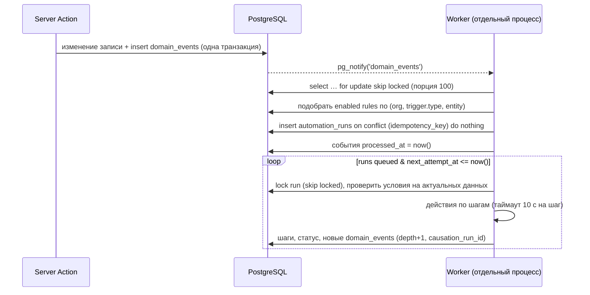

# OWO — спецификация процессов (Pipelines) и автоматизаций

> Проект, ничего не реализовано. Различаем:
> **Pipeline** — набор этапов записи; **Workflow (automation rule)** — правило «триггер → условия →
> действия»; **Run** — одно исполнение правила (workflow instance).

## 1. Pipelines

```sql
create table public.pipelines (
  id uuid primary key default gen_random_uuid(),
  organization_id uuid not null,
  entity_key text not null,                 -- 'leads', 'repair_order', 'event'
  key text not null, label jsonb not null,
  is_default boolean not null default false,
  archived_at timestamptz,
  unique (organization_id, id), unique (organization_id, entity_key, key)
);

-- существующая таблица pipeline_stages расширяется (не заменяется):
alter table public.pipeline_stages
  add column pipeline_id uuid,               -- null = старая воронка лидов (совместимость)
  add column role text not null default 'open'
    check (role in ('entry','open','won','lost')),   -- семантика, а не название
  add column semantic_tags text[] not null default '{}', -- ['contract_sent','client'] — для модулей
  add column sla_minutes int,                -- «ждёт ответа» дольше → событие stage.sla_breached
  add column requires jsonb not null default '[]';     -- условия входа, см. §1.2

create table public.pipeline_transitions (
  organization_id uuid not null,
  pipeline_id uuid not null,
  from_stage text not null,                  -- '*' = из любого
  to_stage text not null,
  allowed_roles text[],                      -- null = все с правом write
  conditions jsonb not null default '[]',
  primary key (pipeline_id, from_stage, to_stage)
);
```
- `kind` (open/won/lost) существующих этапов маппится в `role`; бизнес-смысл в коде и SQL
  читается только из `role` и `semantic_tags`, **никогда из `key` или польского названия**.
  Пример: `client_stage_position()` → «первый этап с тегом `contract_sent`, иначе первый `won`».
- Если у пайплайна нет строк переходов — разрешены все (поведение сегодня).
- Терминальные: `role in ('won','lost')`; выход из терминального — только ролям из
  `pipeline_transitions.allowed_roles` (например, admin «восстанавливает»).

### 1.1 Пример: Barowo и автосервис
```json
{"pipelines":[
 {"key":"lead_flow","entity":"leads","stages":[
   {"key":"new","label":{"pl":"Nowy"},"role":"entry","slaMinutes":10},
   {"key":"contacted","label":{"pl":"Skontaktowano"},"role":"open"},
   {"key":"offer_sent","label":{"pl":"Oferta wysłana"},"role":"open"},
   {"key":"contract_sent","label":{"pl":"Umowa wysłana"},"role":"open","tags":["contract_sent"]},
   {"key":"contract_signed","label":{"pl":"Umowa podpisana"},"role":"won",
    "requires":[{"field":"client_full_name","op":"filled"},{"field":"client_address","op":"filled"}]},
   {"key":"rejected","label":{"pl":"Odrzucony"},"role":"lost"},
   {"key":"spam","label":{"pl":"Spam"},"role":"lost"}]},
 {"key":"repair_flow","entity":"repair_order","stages":[
   {"key":"intake","label":{"pl":"Przyjęcie"},"role":"entry"},
   {"key":"diagnosis","label":{"pl":"Diagnoza"},"role":"open"},
   {"key":"approval","label":{"pl":"Akceptacja klienta"},"role":"open"},
   {"key":"repair","label":{"pl":"Naprawa"},"role":"open","requires":[{"field":"estimate","op":"filled"}]},
   {"key":"handover","label":{"pl":"Wydanie"},"role":"won"},
   {"key":"cancelled","label":{"pl":"Anulowane"},"role":"lost"}],
  "transitions":[
   {"from":"intake","to":"diagnosis"},{"from":"diagnosis","to":"approval"},
   {"from":"approval","to":"repair"},{"from":"repair","to":"handover"},
   {"from":"*","to":"cancelled"}]}
]}
```

### 1.2 Смена этапа — одна функция
`stage_change(org, entity_key, record_id, to_stage, version)` (security invoker):
1. проверка версии (как `change_lead` сегодня);
2. переход разрешён `pipeline_transitions` и ролью;
3. условия `requires` выполнены (те же операторы, что в автоматизациях);
4. запись этапа, `activities('stage_changed')`, `domain_events('record.stage_changed')`;
5. для лидов — сохраняет текущую логику `first_response_at`.
Ошибка возвращает список невыполненных условий — UI показывает их у кнопки.

## 2. События

```sql
create table public.domain_events (           -- outbox: пишется в той же транзакции, что изменение
  id bigint generated always as identity primary key,
  organization_id uuid not null,
  type text not null,                          -- 'record.created', 'record.updated', 'record.stage_changed',
                                               -- 'link.created', 'document.created', 'payment.received',
                                               -- 'webhook.received', 'schedule.tick', 'module.<key>.<event>'
  entity_key text, record_id uuid,
  payload jsonb not null,                      -- {"changed":["stage"],"from":"new","to":"contacted"}
  actor_id uuid,                               -- null = система
  causation_run_id uuid,                       -- если событие вызвано автоматизацией (циклы)
  depth smallint not null default 0,
  created_at timestamptz not null default now(),
  processed_at timestamptz
);
create index domain_events_pending on public.domain_events (id) where processed_at is null;
```
События по времени («наступила дата», «прошло N часов») порождает планировщик:
`scheduled_triggers(org, rule_id, record_id, fire_at, fired_at)` — строка создаётся при
изменении записи (например, `fire_at = due_at - 24h`) и пересчитывается при изменении поля.

## 3. Правила автоматизаций

```sql
create table public.automation_rules (
  id uuid primary key default gen_random_uuid(),
  organization_id uuid not null,
  key text not null, label jsonb not null,
  trigger jsonb not null,       -- {"type":"record.stage_changed","entity":"leads","to":"contract_signed"}
  conditions jsonb not null default '{"all":[]}',
  actions jsonb not null,       -- массив шагов
  enabled boolean not null default true,
  paused_reason text,           -- 'module_disabled', 'error_rate', 'manual'
  max_runs_per_hour int not null default 500,
  config_version_id uuid not null,
  unique (organization_id, id), unique (organization_id, key)
);

create table public.automation_runs (           -- workflow instance
  id uuid primary key default gen_random_uuid(),
  organization_id uuid not null,
  rule_id uuid not null,
  event_id bigint not null,
  record_id uuid,
  status text not null check (status in ('queued','running','waiting','succeeded','failed','skipped','cancelled')),
  step int not null default 0,
  attempts smallint not null default 0,
  next_attempt_at timestamptz not null default now(),
  wait_until timestamptz,                         -- шаг «delay»
  error text,
  idempotency_key text not null,                  -- rule_id + event_id
  started_at timestamptz, finished_at timestamptz,
  unique (organization_id, idempotency_key)
);
create table public.automation_run_steps (
  run_id uuid not null, step int not null, action text not null,
  status text not null, input jsonb, output jsonb, error text, duration_ms int,
  primary key (run_id, step)
);
```

### 3.1 Каталог (реестр `lib/platform/automation/registry.ts`)
**Триггеры:** `record.created`, `record.updated` (+ `fields`), `record.stage_changed`
(+ `from/to/toRole`), `link.created`, `date.reached` (поле + смещение), `time.elapsed`
(с события, если условие ещё верно), `document.created`, `payment.received`, `payment.overdue`,
`webhook.received` (канал), `schedule.cron` (ежедневно HH:MM в часовом поясе организации).

**Условия:** `eq`, `neq`, `gt`, `gte`, `lt`, `lte`, `filled`, `empty`, `in`, `contains`,
`stage.role`, `related.exists` (путь связи), `elapsed` (минуты с поля); группы `all`/`any`
(вложенность ≤ 3).

**Действия:** `set_field`, `set_stage`, `create_record`, `create_task`, `assign_owner`
(конкретный / по кругу / владелец связанной записи), `notify_internal` (push/e-mail/Telegram
участникам), `send_email` (шаблон, только на e-mail записи/контакта, с проверкой отписки),
`send_telegram`, `create_document` (действие модуля документов), `call_webhook` (только
подключение из `integration_connections`), `delay` (ожидание), `module.<key>.<action>`.

Все параметры — значения или шаблоны `{{record.field}}`, `{{contact.first_name}}`
(безопасная подстановка, без выражений).

### 3.2 Примеры правил
```json
[
 {"key":"lead_unanswered_15m","label":{"pl":"Zapytanie czeka 15 min"},
  "trigger":{"type":"time.elapsed","entity":"leads","since":"created_at","minutes":15},
  "conditions":{"all":[{"field":"stage.role","op":"eq","value":"entry"},
                       {"field":"first_response_at","op":"empty"}]},
  "actions":[{"type":"notify_internal","to":"owner_or_all","channels":["push","telegram"],
              "template":"lead_waiting"}]},

 {"key":"contract_signed_payments","label":{"pl":"Po podpisaniu: zadanie o zaliczce"},
  "trigger":{"type":"record.stage_changed","entity":"leads","toTag":"won"},
  "actions":[{"type":"create_task","title":"Sprawdź wpłatę zaliczki","dueInDays":3,"assignTo":"record.owner"}]},

 {"key":"service_reminder","label":{"pl":"Przypomnienie o przeglądzie"},
  "trigger":{"type":"date.reached","entity":"vehicle","field":"next_service_date","offsetDays":-14},
  "actions":[{"type":"send_email","to":"vehicle.owner.email","template":"service_reminder"},
             {"type":"create_task","title":"Zadzwoń: przegląd {{record.plate}}","assignTo":"role:reception"}]},

 {"key":"repair_ready_notify","trigger":{"type":"record.stage_changed","entity":"repair_order","to":"handover"},
  "conditions":{"all":[{"field":"vehicle.owner.phone","op":"filled"}]},
  "actions":[{"type":"send_email","to":"vehicle.owner.email","template":"car_ready"}]}
]
```
Сегодняшние напоминания (`unanswered_15m/2h`, `payment_3d/today/overdue`) становятся
**системными правилами шаблона** — тем же механизмом (этап миграции M5).

## 4. Исполнение



**Правила надёжности:**
- **Никаких автоматизаций в HTTP-запросе**: пользовательская транзакция только пишет событие.
- **Идемпотентность:** `unique (organization_id, idempotency_key)`; внешние действия
  (e-mail, вебхук) передают ключ `run_id:step` в `notification_deliveries`/заголовок `Idempotency-Key`.
- **Повторы:** 5 попыток, экспонента 1 мин → 2 → 4 → 8 → 16; затем `failed` + уведомление OWO.
  Ошибки валидации (нет поля) — сразу `failed`, без повторов.
- **Таймаут** шага 10 с, вебхук 5 с; зависший `running` > 5 мин возвращается в очередь.
- **Циклы:** событие от run получает `depth+1`; при `depth > 5` правила не запускаются, пишется
  `skipped` с причиной `loop_guard`. Плюс одно и то же правило не запускается повторно для той же
  записи чаще 1 раза в 60 с (`last_fired` в `automation_rule_state`).
- **Частота:** `max_runs_per_hour` на правило и 5000/ч на организацию; превышение → правило на
  паузе (`paused_reason='error_rate'|'rate_limit'`) и уведомление OWO.
- **Отключение:** `enabled=false` — новые события игнорируются, queued-runs → `cancelled`;
  отключение модуля ставит его правила на паузу.
- **Права:** действие выполняется от системного актора организации (`auth.uid()` = служебный id
  организации, роль `automation` с правами из конфигурации); записи вне организации недоступны
  по тем же RLS. `call_webhook` — только в заранее подключённые адреса.
- **Журнал:** `automation_runs` + `automation_run_steps` 90 дней, экран «Automatyzacje → Historia»
  в админке OWO; персональные данные в `input/output` не пишутся (только id и ключи полей).

## 5. Задачи и напоминания
`tasks (organization_id, id, record_entity, record_id, title, due_at, assignee_id, done_at,
created_by_run_id)` — замена `lead_tasks`. Напоминание о задаче = системное правило
`date.reached` по `tasks.due_at`. «На сегодня» на Pulpit — представление над `tasks` и
`leads.next_contact_at` (сохраняем поле).

## 6. Тесты движка
См. `OWO_CRM_MIGRATION_PLAN.md` §6: повтор события не создаёт второй run; цикл A→B→A
останавливается на depth 5; отключённое правило не запускается; ошибка шага повторяется
5 раз; запрещённый переход отклоняется с перечнем условий; правило другой организации
не видит записи.
