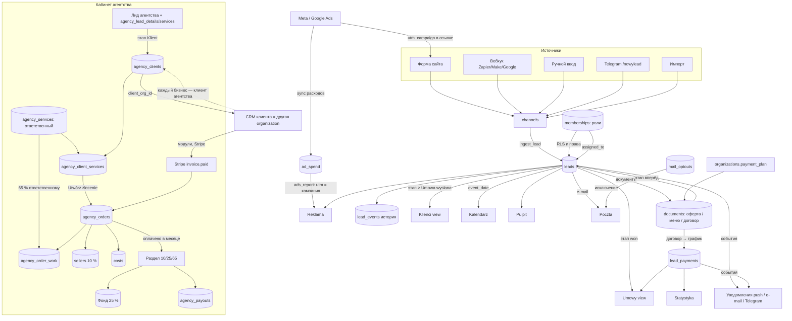
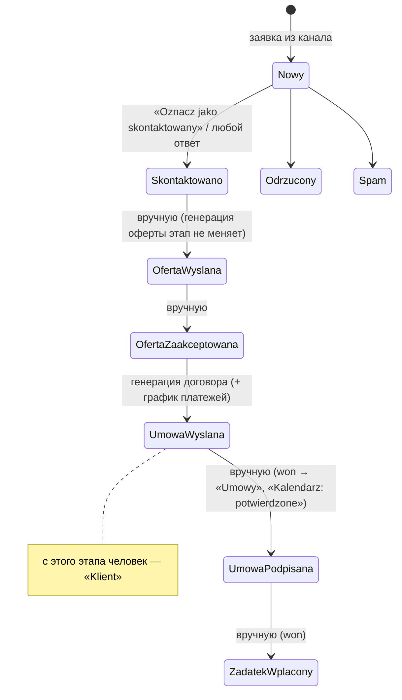
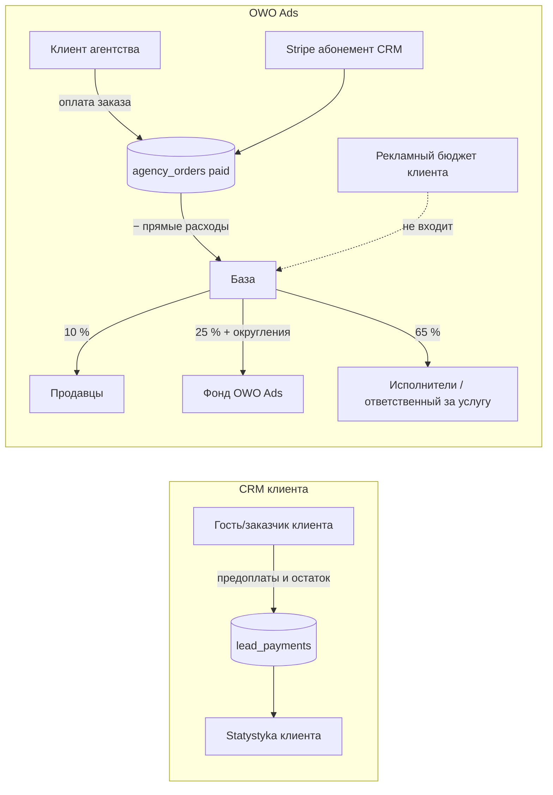

# OWO CRM — сущности, связи и потоки данных

> **Обновление 2026-11-19:** Stripe и встроенные оплаты удалены из приложения (решение 050, D-23). Упоминания Stripe ниже описывают прежнее состояние и историю данных.

> Текущее состояние (2026-11-18). **[Факт]** — подтверждено кодом/миграциями.
> Проверены и предложенные в задании связи — у каждой указано, существует ли она.

## 1. Основные сущности

### 1.1 Платформа и доступ
| Сущность | Таблица | Ключевые поля | Файл |
|---|---|---|---|
| Пользователь | `auth.users` | логин, `is_platform_admin` | `0000_platform` |
| Бизнес (кабинет) | `organizations` | `industry_preset`, `document_engine`, реквизиты, доли агентства `agency_share_*_bp`, `payment_plan` | `0001`, `0015`, `0020`, `0038` |
| Участие | `memberships` | роль `owner/admin/member`, `is_service`, `display_name` | `0001`, `0019` |
| Приглашение | `invitations` | роль, срок 14 дней, хэш токена | `0016` |
| Модули и подписка | `organization_modules`, `organization_billing`, `billing_events`, `module_requests` | модули, Stripe-подписка, запросы модулей | `0021` |

### 1.2 CRM (у каждого бизнеса)
| Сущность | Таблица | Ключевые поля |
|---|---|---|
| Этап воронки | `pipeline_stages` | `key`, `label_pl`, `position`, `kind` open/won/lost |
| Канал (источник) | `channels` | `type` website/webhook/manual/… , `public_key`, `config`, `status` |
| **Лид** | `leads` | контакт, мероприятие, `stage_key`, `assigned_to`, `source_label`, `source_channel_id`, `utm`, `custom_fields`, `first_response_at`, `next_contact_at`, `budget_grosze`, `package_name`, данные договора, `chat_url`, `marketing_consent_at` |
| История лида | `lead_events` | created, edited, stage_changed, note, contacted, call, document_generated, possible_duplicate, restored, file_uploaded … |
| Задача лида | `lead_tasks` | срок, заголовок — **интерфейса нет** |
| Свои поля | `custom_field_defs` | **интерфейса нет** |
| Документ | `documents`, `document_files`, `document_counters` | вид offer/menu/contract, номер, снимок данных, PDF/DOCX |
| Шаблон договора | `organization_templates` | свой `.docx` |
| Файл лида | `lead_attachments` | до 10 МБ |
| Платёж лида | `lead_payments` | `kind` deposit/balance/other, сумма, срок, `paid_at` |
| Почта бизнеса | `organization_mail_settings`, `mail_send_log` | транспорт, лимит |
| Рассылка | `mailing_templates`, `mailing_campaigns`, `mailing_recipients`, `mail_optouts` | |
| Реклама | `ad_accounts`, `ad_spend` | аккаунт Meta/Google/ручной; расход по кампании и дню |
| Уведомления | `notification_settings`, `notification_deliveries`, `push_subscriptions`, `telegram_links` | |

### 1.3 Агентство (только кабинет `agency`)
`agency_clients`, `agency_orders`, `agency_order_sellers`, `agency_order_work`,
`agency_order_costs`, `agency_services`, `agency_client_services`, `agency_lead_details`,
`agency_lead_services`, `agency_fund_expenses`, `agency_fund_contributions`, `agency_payouts`,
`agency_setup_steps`, `agency_setup_marks`, `agency_ad_accounts`.

## 2. Проверка связей из задания

| Связь | Есть? | Как устроено [Факт] |
|---|---|---|
| источник лида → лид | ✅ | Канал создаёт лид через `ingest_lead`; лид хранит `source_channel_id` и текст `source_label`; UTM — в `leads.utm` |
| лид → договор | ✅ | Договор — документ `contract` у лида (`documents.lead_id`), генерируется из карточки; «Umowy» = лиды на этапе `won` |
| договор → событие | ⚠️ частично | Отдельной сущности «событие» нет. Событие календаря = поля мероприятия самого лида; генерация договора записывает дату/город/гостей обратно в лид |
| договор → платежи | ✅ | Генерация договора создаёт график `lead_payments` по плану предоплат бизнеса |
| услуга → заказ | ✅ (агентство) | `agency_orders.service_id`; «Utwórz zlecenie» из услуги клиента |
| заказ → исполнители | ✅ | `agency_order_work`; при услуге — ответственный 100 % автоматически |
| заказ → расходы | ✅ | `agency_order_costs` → `direct_costs_grosze`, вычитаются до раздела |
| заказ → оплата | ✅ | Статус заказа `paid` + `paid_at`; отдельной таблицы оплат заказа нет |
| оплата → финансовая аналитика | ✅ два контура | Платежи лидов → «Statystyka» (`finance_summary`), «Umowy»; оплаченные заказы → «Agencja» (раздел 10/25/65, фонд). Контуры **не связаны** |
| рекламная кампания → источник лида | ⚠️ по совпадению | Связи по ключу нет: `ads_report` сопоставляет `leads.utm.campaign` с именем/ID кампании. `source_label` лида с рекламой не связан |
| участник → права и ответственность | ✅ | Роль в `memberships` → RLS и права действий; участник — `assigned_to` лида, продавец/исполнитель/ответственный за услугу в агентстве (только участники кабинета агентства, триггер `agency_check_member`) |
| лид агентства → клиент агентства | ✅ | На этапе «Klient» кнопка «Dodaj klienta agencji» → `agency_clients.lead_id`; услуги лида переносятся в услуги клиента |
| клиент агентства → CRM клиента | ✅ | `agency_clients.client_org_id` → `organizations`; мастер «Utwórz CRM klienta»; сервисный доступ агентства |
| бизнес → клиент агентства | ✅ | Каждый бизнес установки автоматически — клиент в кабинете агентства (решение 025) |
| абонемент Stripe → заказ агентства | ✅ | `invoice.paid` → оплаченный заказ услуги «CRM (abonament)», комиссия Stripe — прямой расход |
| платёж лида → заказ агентства | ❌ | Нет. Деньги клиента CRM (например, Barowo от своих гостей) не попадают в финансы агентства |
| рекламный бюджет → выручка агентства | ❌ (по правилу) | Бюджет хранится (`ad_budget_grosze`, `monthly_budget_grosze`) только для отчёта |
| расход рекламы (`ad_spend`) → Agencja | ❌ | Новая вкладка «Reklama» и старый блок «Budżet reklamowy» (`agency_ad_accounts`) не связаны |

## 3. Схема связей

## 4. Жизненный цикл лида (кабинет клиента, пресет event-services)

## 5. Потоки денег

## 6. Зависимости разделов (кто от кого берёт данные)

| Раздел | Берёт данные из | Отдаёт данные в |
|---|---|---|
| Źródła leadów | — | Leady |
| Leady / карточка | Źródła, Zespół, Firma (план предоплат), Szablony | Pulpit, Klienci, Umowy, Kalendarz, Poczta, Statystyka, Reklama, Agencja (лид агентства → клиент) |
| Klienci | Leady | — |
| Umowy | Leady, документы, платежи | — |
| Kalendarz | Leady | Pulpit (ближайшие) |
| Poczta | Leady, настройки ящика, отписки | история кампаний |
| Reklama | рекламные аккаунты, Leady (utm, этапы) | — |
| Statystyka | платежи лидов, Leady | — |
| Agencja | заказы, услуги, команда, Stripe, лиды агентства | выплаты, фонд |
| Usługi | Zespół | заказы, услуги клиента, лиды агентства |
| Zespół | приглашения | права везде, ответственные, абонемент (места) |
| Abonament | модули, места | меню (скрытие модулей), Stripe, Agencja |
