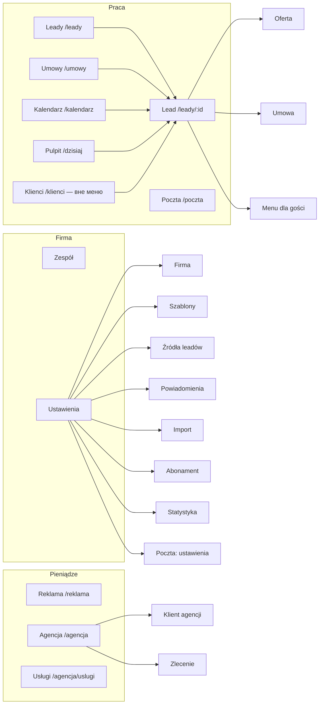

# OWO CRM — общий обзор продукта

> Аудит существующей системы по состоянию на 2026-11-18 (ветка `main`, миграции до `0038`).
> Источники: исходный код репозитория `owo-crm/New-owo-crm`, журнал решений `docs/decisions.md`,
> `docs/agency-distribution.md`. Код не менялся.
>
> Обозначения: **[Факт]** — подтверждено кодом или миграцией; **[Предположение]** — вывод,
> который код прямо не подтверждает; **[Рекомендация]** — мнение аналитика для будущего редизайна.
> Документ описывает **текущее** состояние, а не будущую концепцию.

Связанные документы: [Модули](OWO_CRM_MODULES.md) · [Потоки данных](OWO_CRM_DATA_FLOW.md) ·
[Требования к редизайну](OWO_CRM_UX_REQUIREMENTS.md) · [Открытые вопросы](OWO_CRM_OPEN_QUESTIONS.md)

---

## 1. Что это за продукт

**[Факт]** OWO CRM — одна установка, в которой живут два вида рабочих пространств
(«бизнесов», таблица `organizations`):

| Вид | Пример | Как отличается | Для чего |
|---|---|---|---|
| **Кабинет агентства** | OWO Ads | `industry_preset = 'agency'` (`lib/presets/index.ts`, `isAgency`) | Свои лиды агентства + финансы агентства (`/agencja`), каталог услуг, клиенты агентства, распределение прибыли |
| **Кабинет клиента** | barowo | `industry_preset = 'event-services'` (или другой пресет) | CRM клиента агентства: заявки, оферты/договоры, платежи, календарь мероприятий, рассылки |

Изначально продукт строился как CRM для Barowo — бизнеса выездного бара и шоколадного фонтана
на мероприятиях (решения 001, 006). Поэтому модель лида «заточена» под **мероприятие с датой**
(`event_date`, `event_type`, `event_city`, `venue`, `guests`, `service_hours`), а документы
(оферта, меню для гостей, договор) — под шаблоны Barowo (`lib/documents/barowo/*`). Позже
(решение 021) в ту же установку добавлен кабинет самого агентства OWO Ads.

**[Факт]** OWO Ads продаёт клиентам доступ к OWO CRM как подписку по модулям через Stripe
(решение 022, `lib/billing/*`). Каждый бизнес установки автоматически становится клиентом
в кабинете агентства (решение 025).

## 2. Технологическая архитектура

**[Факт]** (решение 017, `docs/01-architecture.md`):

- **Next.js 16 (App Router)**, серверные компоненты и Server Actions; один монолит.
- **PostgreSQL** (Railway). Вся бизнес-логика расчётов — в SQL-функциях (`db/migrations/*.sql`):
  `work_queue`, `dashboard_charts`, `calendar_events`, `clients_list`, `contracts_list`,
  `finance_summary`, `ads_report`, `mailing_*`, `agency_order_split` и др.
- **RLS** на каждой таблице с `organization_id`: запросы пользователя идут через
  `withOrg` (`lib/db/user.ts`), который выставляет пользователя и бизнес в транзакции.
- Миграции применяются при старте (`scripts/migrate.ts`), деплой из ветки `main` на Railway.
- Интерфейс только на польском (`messages/pl.json`), типизированные ключи `t("…")`.
- Деньги везде хранятся в **грошах** (целые числа), часовой пояс расчётов — `Europe/Warsaw`.
- Фоновая работа (уведомления, рассылки, синхронизация рекламы) — минутный воркер
  (`lib/notify/runner.ts`, `worker.ts`), внешние отправки включаются переменной
  `OUTBOUND_NOTIFICATIONS_ENABLED`.
- Живое обновление списков — `/api/live` (LISTEN/NOTIFY, `lib/db/listen.ts`, компонент `LiveUpdates`).
- PWA: установка на телефон (`/zainstaluj`), push-уведомления (VAPID).

## 3. Доступ и роли

**[Факт]** (решения 019, 023, 030, 038; `db/migrations/20261012000001_organizations.sql`,
`lib/team/*`):

- Пользователь (`auth.users`) участвует в бизнесах через `memberships` с ролью
  `owner` / `admin` / `member`.
  - `owner` — всё; роль меняет только owner, последнего владельца понизить нельзя.
  - `admin` — настройки, команда, удаление.
  - `member` — лиды и документы.
- **Админ платформы** (`is_platform_admin`, логин из переменных Railway `ADMIN_LOGIN`):
  автоматически участвует во всех бизнесах (admin + `is_service`), в кабинете агентства — owner.
  Только он создаёт новые бизнесы («Nowy biznes» / мастер «Utwórz CRM klienta»).
- **Сервисный доступ агентства**: владельцы/админы кабинета OWO Ads автоматически становятся
  обслуживающими участниками (`is_service`) в кабинетах своих клиентов; такие участники
  не считаются платными местами и не могут быть удалены клиентом.
- Переключатель бизнеса — cookie `owo_org`.

## 4. Модули подписки (что включено у бизнеса)

**[Факт]** `lib/billing/modules.ts`, таблица `organization_modules`:

| Ключ | Название (PL) | Цена netto/мес | Что открывает в интерфейсе (по коду) |
|---|---|---|---|
| `leads` | Leady (база) | 39 zł | Всегда включён |
| `channels` | Dodatkowe kanały | 29 zł | **Неизвестно — требуется уточнение**: проверка модуля в коде не найдена |
| `documents` | Oferty i umowy | 59 zł | Генерация оферты/меню/договора, `/umowy`, `/poczta`, `/dokumenty` |
| `payments` | Płatności | 29 zł | Платежи в карточке лида, `/statystyka` |
| `calendar` | Kalendarz | 19 zł | `/kalendarz`, ссылка «Kalendarz» на Pulpit |

Пользователь сверх включённого +15 zł; «Pakiet Pełny» 149 zł (3 пользователя) применяется,
если он дешевле. Клиенту рекламы — база 0, модули −50 %. Выключенный модуль показывает экран
«Poproś o moduł» (`components/billing/module-locked.tsx`).

## 5. Текущая навигация

**[Факт]** `components/app-shell/nav-items.ts` (состояние на момент аудита):

| Группа | Пункт | Адрес | Видимость |
|---|---|---|---|
| **Praca** (работа) | Pulpit | `/dzisiaj` | все |
| | Leady | `/leady` | все |
| | Umowy | `/umowy` | модуль `documents` |
| | Kalendarz | `/kalendarz` | модуль `calendar` |
| | Poczta | `/poczta` | модуль `documents` |
| **Pieniądze** (деньги) | Reklama | `/reklama` | все бизнесы |
| | Agencja | `/agencja` | только кабинет агентства |
| | Usługi | `/agencja/uslugi` | только кабинет агентства |
| **Firma** (компания) | Zespół | `/ustawienia/zespol` | все |
| | Ustawienia | `/ustawienia` | все |

Внутри «Ustawienia» (в боковом меню их нет, доступны через поиск ⌘K): Firma, Szablony,
Źródła leadów, Powiadomienia, Import leadów, Abonament, Statystyka, Poczta (настройки ящика).

**[Факт]** Пункт **Klienci** (`/klienci`) удалён из меню 2026-11-18 (решение 049), сама страница
работает. Страница `/dokumenty` существует, но не в меню и показывает только пустое состояние.

Телефон: нижняя панель «Leady · Kalendarz (или Pulpit) · Statystyka (у агентства — Agencja) ·
Menu», «＋ Nowy lead» в верхней панели (решение 048).

## 6. Ключевая модель: всё вращается вокруг лида

**[Факт]** Центральная сущность — **лид** (`public.leads`). Разделы Leady, Klienci, Umowy,
Kalendarz, Pulpit, Statystyka, Poczta и Reklama — это разные **взгляды на одну таблицу лидов**,
а не отдельные сущности:

- *Lead* — любое обращение;
- *Klient* — лид на этапе «Umowa wysłana» и дальше, склеенный по телефону/e-mail (`clients_list`);
- *Umowa* — лид на этапе вида `won` (`contracts_list`);
- *событие календаря* — лид с `event_date` на открытом или выигранном этапе (`calendar_events`);
- *контакт рассылки* — лид с e-mail (`mailing_contacts`).

Кабинет агентства использует ту же таблицу лидов для своих продаж, но финансы агентства —
**отдельная модель** (`agency_clients`, `agency_orders`, `agency_services` …), не связанная
с платежами лидов (`lead_payments`).

Подробно — в [OWO_CRM_DATA_FLOW.md](OWO_CRM_DATA_FLOW.md).

## 7. Карта экранов

